<h1 align="center" style="color: #ffffff; margin-bottom: 4px;">
  Hello CodeDrunkards, I'm Sankalp Singh!  
  
</h1>

  

I'm a student building Full-Stack WAPs & MCP servers while learning networking and automation (BTW, I love networking!). I also bring a year of hands-on experience in SEO and keyword research to make sure what I build actually gets found. (...If you're good at **building**, you should be good at **distribution** too.)

- Building open-source and closed-source MCP servers that give AI agents the abilities they lack, and full-stack WAPs and improving workflows in Agentic AI to ship solid, low-bug web apps (not that AI-Slop)
- Studying network architecture and traffic analysis
- Experienced in keyword research and SEO/GEO/AEO

---

## --- THIS IS ALL I USE 

  
  
  
  
  
  
  
  
  
  
  
  
  
  
  
  
  
  
  
  
  
  
  
  
  
  
  
  
  
  
  
  
  
  
  
  
  
  
  
  
  
  
  
  
  
  
  
  
  
  
  
  
  
  
  
  
  
  
  
  
   
  

---

<picture>
  <source media="(prefers-color-scheme: dark)" srcset="https://raw.githubusercontent.com/sankalpsinghcoder-ai/sankalpsinghcoder-ai/output/pacman-contribution-graph-dark.svg">
  <source media="(prefers-color-scheme: light)" srcset="https://raw.githubusercontent.com/sankalpsinghcoder-ai/sankalpsinghcoder-ai/output/pacman-contribution-graph.svg">
  
</picture>
